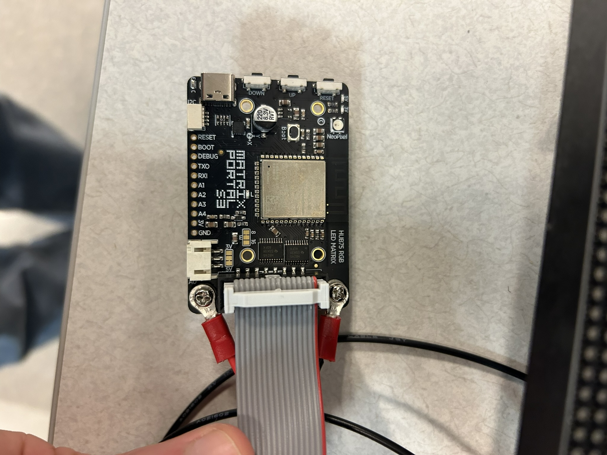
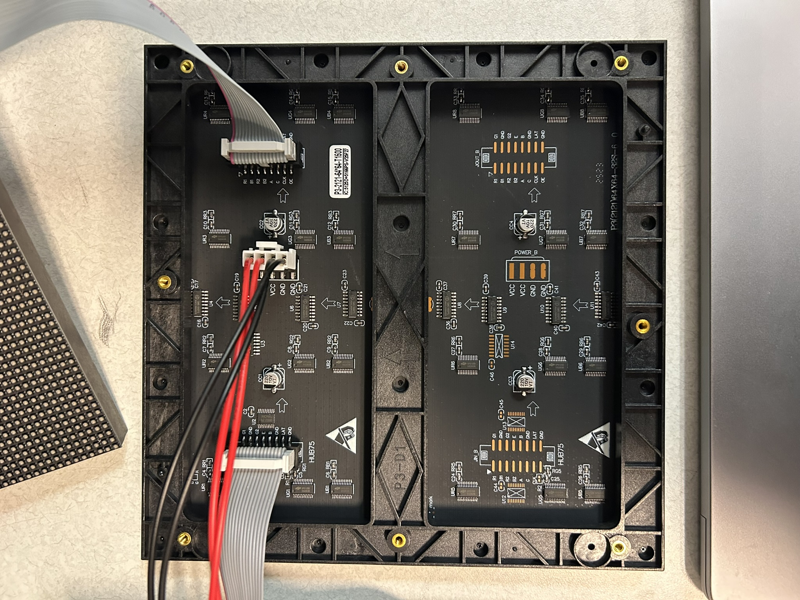
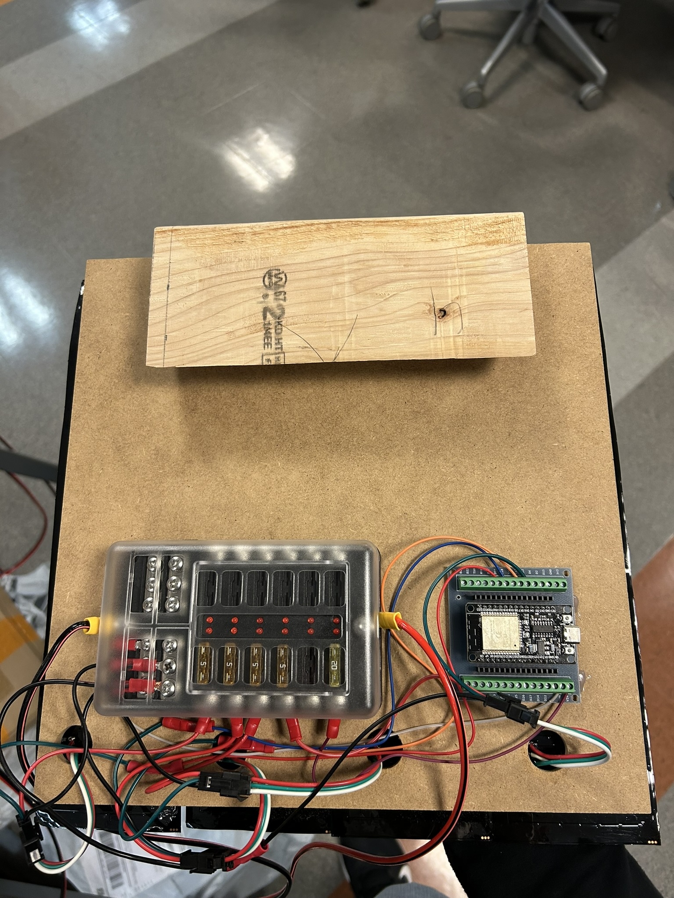

# Video Wall Hardware Configuration

## P3 64x64 Matrix Video Wall

Hardware:
- Microcontroller: [Adafruit Matrix Portal S3 (WiFi)](https://www.adafruit.com/product/5778)
- LED Matrix: [64x64 P3 LED Matrix](https://www.adafruit.com/product/5407)
- Blade fuse box

Each microcontroller can control up to six daisy-chained 64x64 matrices (due to a memory limitation).

The microcontroller has a 2x10 socket connector to connect the first matrix:

The matrix needs its own power supply from the fuse box

Subsequent microcontrollers can be "daisy-chained" by connecting them to previous matrices, as seen above.

## WS2812B Matrix Video Wall

Hardware:
- Microcontroller: __ESP32__
- LED Matrix: __32x8 WS2812B Matrix__
- Blade fuse box

Each microcontroller controls a 32x32 square chunk of LEDs, consisting of four 32x8 WS2812B matrices.

The wiring of each chunk looks like this:

On the bottom left is the fuse box where all power is routed. Each LED matrix is given a 5 Amp fuse. 

The ESP32 microcontroller is on the bottom right. The signal pin of each LED matrix gets connected to a GPIO pin on the microcontroller. Any GPIO pins will work but 16, 17, 18, and 19 are typically used. These pin numbers need to be declared in the matrix configuration YAML file for the microcontroller to know what to control.
